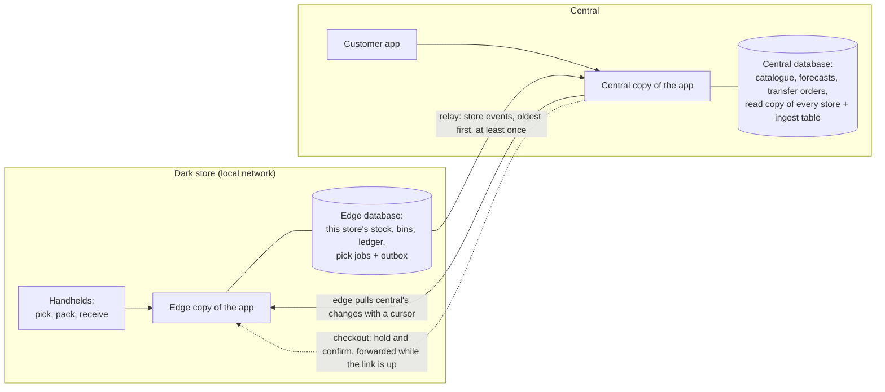
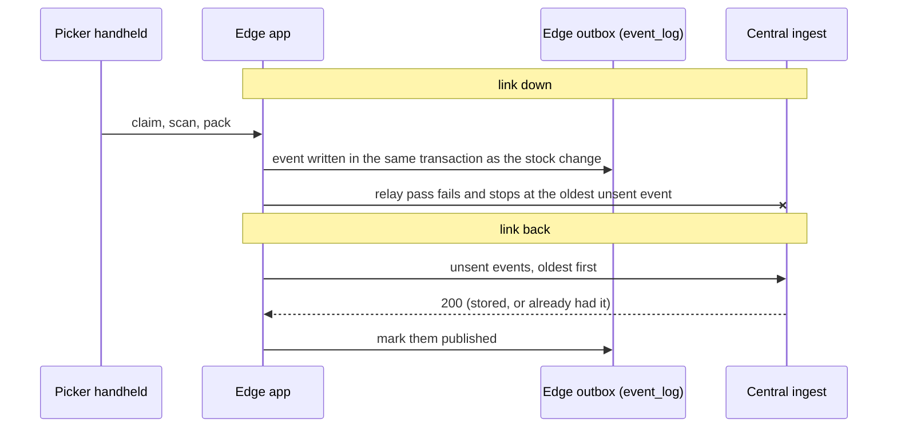

# Store edge node: design note

HLD 5 puts a small "edge node" in every dark store. This note says what it would do, how it would sync with the
central system, and what happens when the link between them fails. The prototype does not run a second copy of
the app, but an experiment (`tests/test_edge_node.py`, section 8) runs the outage and the replay against the
relay we already have.

## 1. The problem

Today every handheld in the store talks to the one central app. If the store's internet link drops, pickers
cannot claim orders, scan or pack, and receivers cannot put a truck away. The work is physically in the store, so
the software that runs it should be too.

## 2. The idea

Each store runs its own copy of the app (the **edge**) on a small machine on the store's network. The handhelds
talk to the edge. The edge sends everything that happens to the central copy as events, and gets back what
central decides (new transfer orders, reorder points, catalogue changes).

## 3. Who owns what

Every piece of data has exactly **one writer**. Then the two sides never edit the same row, and there are no
conflicts to merge after an outage: the other side only ever applies events in order.

| Data | Written by | The other side has |
| --- | --- | --- |
| The store's stock levels, bins, batches and ledger | Edge | Central: a read copy built from `stock.changed` |
| Pick jobs, scans, packing, handover | Edge | Central: a read copy, for the ops dashboard and KPIs |
| Goods receipts and putaway | Edge | Central: a read copy; it closes the transfer order |
| Holds and payments (checkout) | Edge, asked by central | Central: the customer's order |
| Catalogue, assortment, prices | Central | Edge: a copy, pulled |
| Forecasts and reorder points | Central | Edge: a copy, pulled |
| Transfer orders | Central | Edge: a copy, so the receiver can check the truck |

## 4. Checkout while the store is cut off

A customer is never in the store, so the customer app always talks to central. A hold has to change the store's
stock, which only the edge may write. Two ways to handle that:

- **A. Forward every hold and confirm to the edge (chosen).** Central passes `POST /v1/reservations` and
  `.../confirm` to the store's edge and returns its answer. Stock stays exact: the last ice cream is still
  decided by one statement in one database. While the link is down, the store cannot sell. Central notices that
  the store has gone quiet and marks it `closed`; serviceability already refuses closed stores, so customers
  nearby are told "not serviceable" (or, later, sent to a neighbour) instead of being sold something nobody
  can confirm. Orders paid before the outage are already on the edge, and the store keeps picking them.
- **B. Lease each store a quota.** Central may sell up to N units of each item without asking; the edge keeps
  those units aside. Sales continue during an outage, but a small amount of stock is held back all the time,
  and the quotas need topping up. Worth it only if outages turn out to be common.

The one gap in A: if the link drops after central has taken the money but before the edge has confirmed, the
hold expires on the edge and the customer must be refunded. That is the refund saga HLD lists for Member 2.

## 5. Replay after an outage

The rules, and where the prototype already follows them:

1. **Nothing is lost.** `events.publish` writes the event in the same transaction as the change it describes,
   so if the stock change is saved, so is its event, even through a power cut.
2. **Order is kept.** The relay (`events.relay_once`) sends unsent events by id and stops at the first one that
   fails, so central sees each store's events in the order they happened. Order by event id, not by time: the
   edge's clock can be wrong.
3. **Delivery is at least once.** If the edge crashes after sending a batch but before marking it, it sends the
   batch again. Central must drop duplicates: its ingest table has a unique key on (store, event id), and a
   duplicate is answered 200 without being applied twice. Event ids are only unique inside one edge database,
   which is why the store is part of the key. Member 1's `app/idempotency.py` uses the same idea for retried
   writes.
4. **Catch-up has a speed limit.** The relay sends at most `RELAY_BATCH_SIZE` (100) events per pass, a pass
   every `RELAY_INTERVAL_SECONDS` (0.2 s): up to 500 events a second. A busy store makes a few events per
   order, so even a day offline drains in minutes.

The other direction works the same way: central keeps its own outbox, and each edge asks for "everything after
the last id I have", so a reconnecting edge just carries on from its cursor.

## 6. When things fail

| What fails | The store | Central | Data at risk |
| --- | --- | --- | --- |
| Internet link down | Keeps picking, packing and receiving; events wait in the outbox | Stops hearing from the store; after 15 minutes the existing "store offline" alert fires (`store_seconds_since_last_event > 900`) and the job in section 9 marks the store closed | None |
| Central down | Same as above | Not running | None |
| Edge crashes after sending, before marking | Sends the batch again after the restart | Drops the duplicates by key | None |
| Edge power cut | Everything committed is on disk, with its event | Same as link down | None that was committed |
| Edge disk lost | Starts empty | Has everything up to the last relayed event | Events not yet relayed; a cycle count (Member 1, task 1.5) puts the stock right |
| Outage of hours | Outbox grows by a few rows per order | `outbox_lag_seconds` grows on the edge | None, unless the edge disk fills |
| Edge clock wrong | Nothing breaks: order is by event id | KPIs that use event times are off for that store | None |

## 7. Security

- Each edge has its own credential (a client certificate, or a token that names its store). Central accepts
  events from an edge only for that edge's store: the same "own store only" rule `check_store` applies to staff.
- Staff log in on the edge, and the edge must check their tokens while offline. Today tokens are signed with
  HS256 and one shared secret; an edge holding that secret could mint a token for any store. The edge needs a
  public key only, so central would sign with an asymmetric algorithm (EdDSA or RS256).

## 8. The experiment

`tests/test_edge_node.py` runs the outage against the relay as it is, with no app changes. Central is stood in
for by a sink, the hook a real HTTP forwarder would use (`events.add_sink`).

| Run | What happens | Result |
| --- | --- | --- |
| Outage | Link down; two paid orders and a picker's claim | All three calls succeed. 7 events queue (`stock.changed`, `order.paid`, `fulfilment.state_changed` for each order, and the claim's `fulfilment.state_changed`). Three relay passes send nothing. When the link is back, all 7 arrive, oldest first, once each. |
| Crash after sending | The edge's commit fails after the batch was sent | The batch is sent again; every event arrives twice and central keeps each once, in order. |
| Broken relay (checked by hand) | The line that stops at the first failure is removed | The outage test fails: events are marked sent though central never got them. |

Run it with `python -m pytest tests/test_edge_node.py -v`.

## 9. To build it for real

| Piece | Size |
| --- | --- |
| A sink that POSTs each event to central, with a short timeout | about 20 lines |
| Central's ingest endpoint and table, unique on (store, event id) | about 40 lines and tests |
| Central's outbox and the edge's cursor-based pull | about 40 lines |
| A job that marks a silent store closed and reopens it when events resume | about 20 lines |
| A setting for which copy runs which modules, and asymmetric token signing | config and `auth.py` |

Not covered here: running two copies on two machines over a real network, and sharding central by store.
